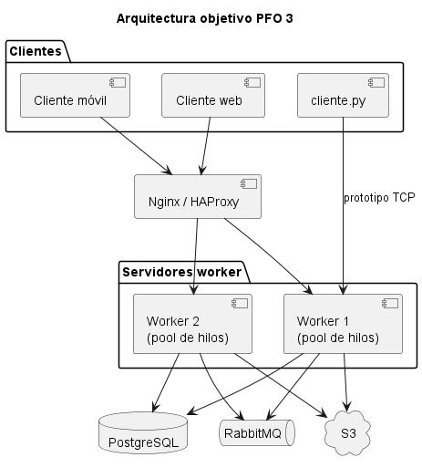
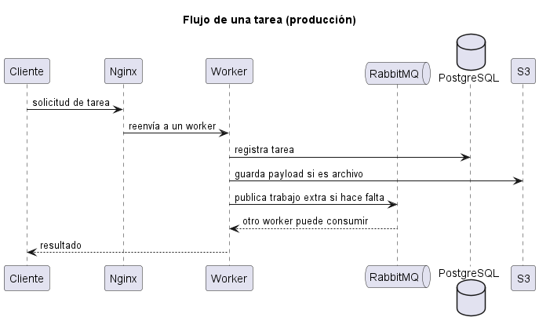
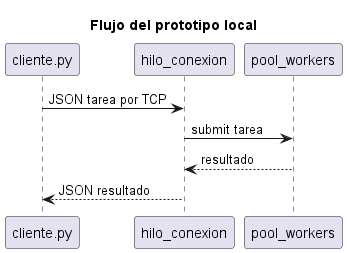

# PFO 3: rediseño como sistema distribuido (cliente-servidor)

**Materia:** Programación sobre Redes  
**Objetivo:** transformar el sistema de tareas en una arquitectura distribuida usando sockets.

**Trabajo realizado por Ailén Páez de la comisión E para el PFO2, Programación sobre redes.**

----

1. El **diagrama** de la arquitectura objetivo (clientes, Nginx/HAProxy, workers con pool de hilos, RabbitMQ, PostgreSQL y S3).
2. Un **prototipo en Python**: servidor TCP que reparte tareas a un pool de workers y un cliente que envía tareas y recibe resultados.

## Índice

- [PFO 3: rediseño como sistema distribuido (cliente-servidor)](#pfo-3-rediseño-como-sistema-distribuido-cliente-servidor)
  - [Índice](#índice)
  - [Arquitectura objetivo vs prototipo](#arquitectura-objetivo-vs-prototipo)
  - [Diagrama del sistema (arquitectura objetivo)](#diagrama-del-sistema-arquitectura-objetivo)
  - [Componentes](#componentes)
    - [Clientes (móvil, web y consola)](#clientes-móvil-web-y-consola)
    - [Balanceador de carga (Nginx o HAProxy)](#balanceador-de-carga-nginx-o-haproxy)
    - [Servidores worker (pool de hilos)](#servidores-worker-pool-de-hilos)
    - [Cola de mensajes (RabbitMQ)](#cola-de-mensajes-rabbitmq)
    - [Almacenamiento distribuido](#almacenamiento-distribuido)
  - [Flujos](#flujos)
    - [Flujo de una tarea (producción)](#flujo-de-una-tarea-producción)
    - [Flujo del prototipo local](#flujo-del-prototipo-local)
  - [Protocolo del prototipo](#protocolo-del-prototipo)
  - [Requisitos](#requisitos)
  - [Cómo correr](#cómo-correr)
  - [Pruebas](#pruebas)
  - [Estructura](#estructura)

## Arquitectura objetivo vs prototipo

En producción, móviles y web entrarían por un **balanceador** (Nginx o HAProxy) hacia varios **servidores worker**. Esos procesos se coordinarían con **RabbitMQ** y persistirían en **PostgreSQL** y **S3**.

Lo que se puede ejecutar en una PC es el recorte pedido por el enunciado:

`cliente.py` → socket TCP → `servidor.py` (hilo por cliente + `ThreadPoolExecutor`).

El resto del diagrama describe cómo se desplegaría el mismo sistema en producción.

| Capa | En el diseño | En este repo |
|------|----------------|--------------|
| Clientes (móvil, web) | Apps que envían tareas al balanceador | `cliente.py` por consola, socket TCP |
| Balanceador (Nginx / HAProxy) | Reparte conexiones entre varios servidores | No se levanta; un solo proceso servidor |
| Servidores worker + pool de hilos | Varias instancias, cada una con hilos | Un `servidor.py` con `ThreadPoolExecutor` |
| Cola (RabbitMQ) | Comunicación asíncrona entre servidores | No se usa; el pool interno reparte tareas |
| PostgreSQL | Metadatos y resultados persistentes | No se usa |
| S3 | Archivos / payloads grandes | No se usa |

## Diagrama del sistema (arquitectura objetivo)



## Componentes

### Clientes (móvil, web y consola)

Envían una **tarea** (identificador, tipo y payload) y esperan un **resultado**. En producción entrarían por HTTP/TLS al balanceador. En el prototipo, `cliente.py` abre un socket TCP directo al worker local.

### Balanceador de carga (Nginx o HAProxy)

- Recibe conexiones de muchos clientes.
- Reparte el tráfico entre instancias de servidor (round-robin o least-connections).
- Permite sacar un worker de servicio sin cortar todo el sistema.

En el prototipo no hay balanceador porque corre **un solo servidor** en `127.0.0.1`.

### Servidores worker (pool de hilos)

Cada proceso servidor:

1. Acepta conexiones (`listen` / `accept`).
2. Mantiene un **pool de hilos** para no bloquear el socket mientras procesa.
3. Ejecuta el tipo de tarea pedido (`echo`, `reverse`, `sum`, `sleep`, etc.).
4. Devuelve el resultado al cliente.

Varios workers permiten escalar CPU y fallos: si uno cae, el balanceador sigue enviando al resto.

### Cola de mensajes (RabbitMQ)

En un despliegue real, los workers no se llaman entre sí por sockets ad-hoc. Publican y consumen mensajes:

- Un servidor puede encolar trabajo pesado para otro.
- Los picos se absorben en la cola en lugar de saturar hilos.
- Si un worker muere, el mensaje puede reintentarse.

En el prototipo esa función la cumple el **`ThreadPoolExecutor` interno** (cola de trabajo en memoria del proceso).

### Almacenamiento distribuido

- **PostgreSQL**: usuarios, estado de la tarea, resultado estructurado, auditoría.
- **S3** (u object storage compatible): archivos adjuntos, logs grandes, artefactos.

El prototipo no persiste: el resultado vive solo en la respuesta JSON del socket.

## Flujos

### Flujo de una tarea (producción)



### Flujo del prototipo local



## Protocolo del prototipo

Mensajes JSON, un objeto por línea (`\n` como delimitador).

Tarea:

```json
{"id": "1", "tipo": "sum", "payload": [1, 2, 3]}
```

Respuesta:

```json
{"id": "1", "ok": true, "resultado": 6}
```

Si falla:

```json
{"id": "1", "ok": false, "error": "tipo de tarea desconocido"}
```

## Requisitos

- Python 3.10 o superior (solo biblioteca estándar).
- Opcional: `pytest` o el `unittest` incluido en Python.

## Cómo correr

Terminal 1:

```bash
python servidor.py
```

Debería mostrar algo como: `Servidor en 127.0.0.1:5000 (pool de 4 workers)`.

Terminal 2:

```bash
python cliente.py
```

Tipos de tarea:

| Tipo | Payload | Ejemplo |
|------|---------|---------|
| `echo` | cualquier valor | `hola` |
| `reverse` | texto | `redes` → `seder` |
| `sum` | números separados por coma | `1,2,3` → `6` |
| `sleep` | segundos (0–30) | `2` (sirve para ver el pool de hilos) |
| `salir` | — | cierra el cliente |

Se pueden abrir **varios clientes** a la vez contra el mismo servidor.

## Pruebas

```bash
python -m unittest discover -s tests -v
```

## Estructura

```
config.py       host, puerto y tamaño del pool
protocolo.py    JSON por línea sobre el socket
tareas.py       echo, reverse, sum, sleep
servidor.py     accept + hilo por cliente + ThreadPoolExecutor
cliente.py      menú de consola
docs/           diagrama y explicación
tests/          unitarias + integración por socket
```
